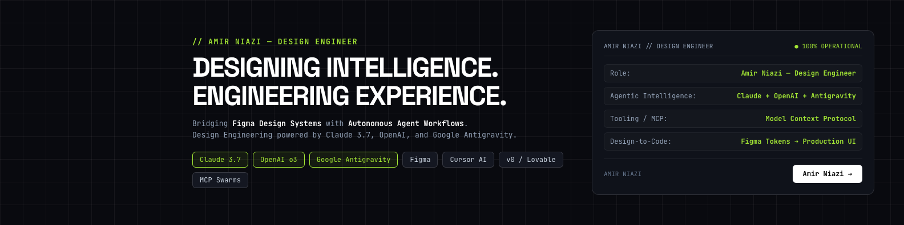

<div align="center">

  <!-- Header Banner -->
  <a href="https://www.linkedin.com/in/amirniaziuiux">
    
  </a>
</div>

---

### 💻 `whoami.sh`

```bash
amir@agent-core:~$ whoami
> Name:       Amir Niazi
> Title:      Amir Niazi — Design Engineer
> Speciality: Translating Figma designs into production AI agents & interfaces at 10x velocity.
> Core Stack: Claude 3.7 • OpenAI o3/GPT-4o • Google Antigravity • Figma • Cursor • MCP
> Terminal:   "Code that converts. Systems that think."
```

---

### ⚡ About Me

I am **Amir Niazi**, a **Design Engineer** specializing at the intersection of **product design, frontier LLM orchestration, and autonomous agent workflows**. 

- 🧠 **Agent Architect**: I build resilient multi-agent systems and MCP (Model Context Protocol) tool-calling architectures using **Claude 3.7**, **OpenAI o3/GPT-4o**, and **Google Antigravity**.
- ⚡ **Vibe Coding Pioneer**: High-speed, high-quality development leveraging **Cursor AI**, **Claude Code**, **v0**, and **Lovable** to ship production-ready applications in days, not months.
- 🎨 **Design-Obsessed Engineer**: Every AI system I build starts with high-fidelity **Figma** design systems, ensuring pixel-perfect UX, glassmorphism, fluid micro-interactions, and conversion-focused design.

---

### 🛠️ The AI Agent & Vibe Coding Stack

<div align="center">

| Domain | Frontier Technologies & Frameworks |
| :--- | :--- |
| **🧠 Frontier AI & LLMs** | `Claude 3.7 Sonnet` • `Claude 3.5 Opus` • `OpenAI o3-mini` • `GPT-4o` • `Google Gemini 2.5 Pro/Flash` |
| **⚡ Vibe Coding & AI IDEs** | `Cursor AI` • `Claude Code CLI` • `v0 by Vercel` • `Lovable.dev` • `Bolt.new` • `Windsurf` |
| **🎨 Design & Prototyping** | `Figma (Design Systems & AutoLayout)` • `Framer` • `Tailwind CSS` • `Modern Vanilla CSS` |

</div>

<br/>

<div align="center">
  <!-- Interactive Shields Grid -->
  
  
  
  
  
  
  

</div>

---

### 🔄 Autonomous Workflow Architecture

How I build products from initial spark to enterprise deployment:

```mermaid
flowchart LR
    A[🎨 Figma Design Tokens & Specs] --> B[⚡ Vibe Ideation: v0 / Lovable]
    B --> C[🧠 Claude 3.7 & OpenAI Multi-Model Reasoning]
    C --> D[🤖 Google Antigravity Agent Swarm]
    D --> E[🔌 Model Context Protocol MCP Tools & DB]
    E --> F[🚀 Production Deployment: Next.js + Cloud]
    
    style A fill:#1a1d24,stroke:#ff7262,stroke-width:2px,color:#fff
    style B fill:#1a1d24,stroke:#38bdf8,stroke-width:2px,color:#fff
    style C fill:#1a1d24,stroke:#D97706,stroke-width:2px,color:#fff
    style D fill:#1a1d24,stroke:#a3e635,stroke-width:2px,color:#fff
    style E fill:#1a1d24,stroke:#c084fc,stroke-width:2px,color:#fff
    style F fill:#1a1d24,stroke:#10a37f,stroke-width:2px,color:#fff
```



---

### 🚀 Featured Highlights

#### 🤖 Multi-Agent MCP Workflow Engine
> Autonomous task planning and execution pipeline using Anthropic Claude 3.7 & Google Antigravity. Connects live databases, GitHub APIs, and web scrapers via custom MCP servers.
>
> **Tech Stack:** `Python` • `Claude 3.7` • `MCP Protocol` • `FastAPI` • `Docker`

<br/>

#### 🎨 Figma-to-Code Vibe Pipeline
> High-velocity development workflow that translates complex Figma design components directly into accessible, animated Next.js apps using Cursor AI and specialized custom skills.
>
> **Tech Stack:** `Next.js` • `TypeScript` • `Tailwind CSS` • `Cursor AI` • `v0`

<br/>

#### ⚡ Enterprise RAG & Neural Search
> Production document intelligence pipeline with hybrid vector embeddings, reranking models, and streaming conversational UI with sub-second latency.
>
> **Tech Stack:** `OpenAI o3-mini` • `pgvector` • `Supabase` • `LangChain`

<br/>

#### ✨ AI Agent Design System
> Tailored Figma UI kit and React component library specifically optimized for AI agent interfaces, generative streaming, thought-traces, and tool execution feedback.
>
> **Tech Stack:** `Figma` • `React` • `CSS Variables` • `Framer Motion`

---

### 📊 GitHub Telemetry

<div align="center">
  
  
</div>

---

### 📬 Connect & Collaborate

I am currently open to **high-impact Design Engineering roles, technical advisory, and select contract engagements** in AI Agent Architecture and Product Design.

<p align="center">
  <a href="https://www.linkedin.com/in/amirniaziuiux">
    
  </a>
  &nbsp;
  <a href="https://github.com/AmirNiazi7">
    
  </a>
  &nbsp;
  <a href="https://www.behance.net/amirniazi5">
    
  </a>
  &nbsp;
  <a href="https://wa.me/923203554500">
    
  </a>
  &nbsp;
  <a href="mailto:amirniazi369@gmail.com">
    
  </a>
</p>

<br/>

<div align="center">
  <sub>Amir Niazi — Design Engineer • Powered by Autonomous Agent Workflows</sub>
</div>
